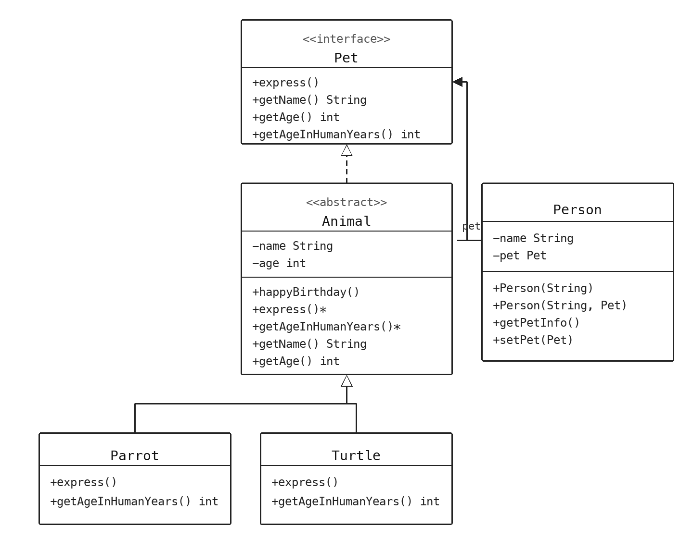
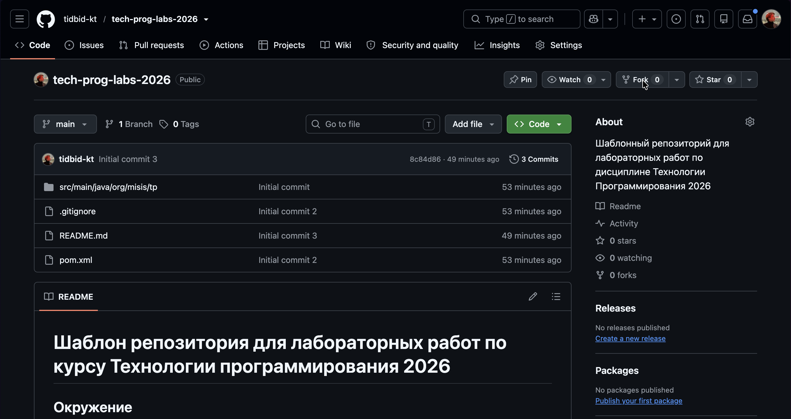
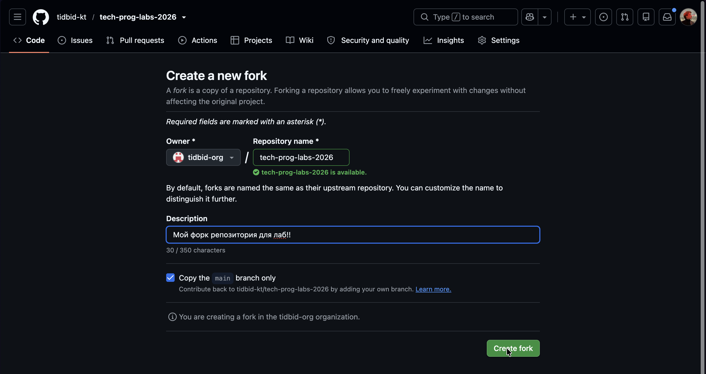
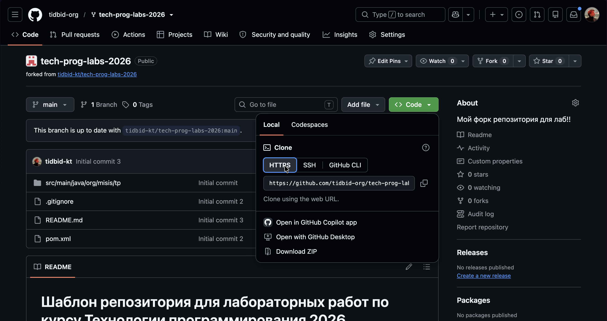
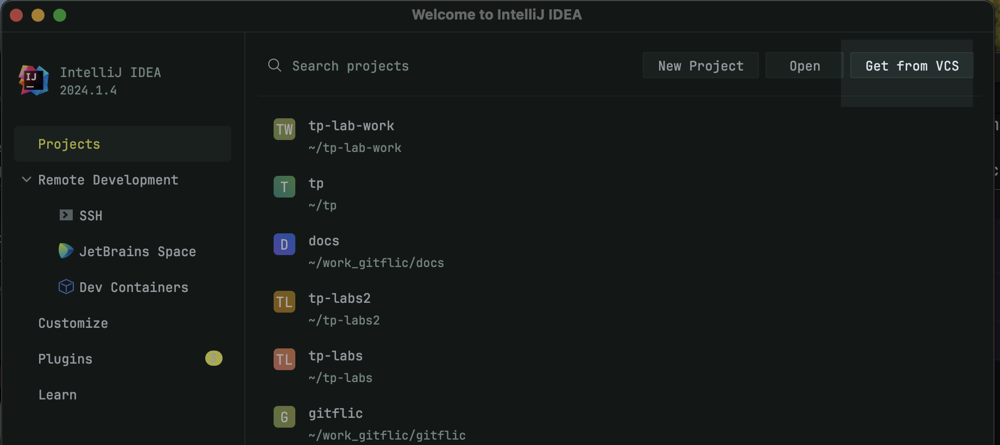
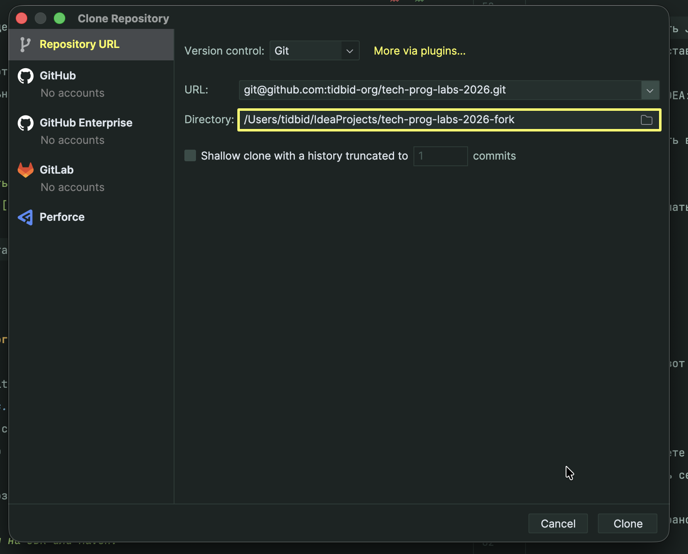
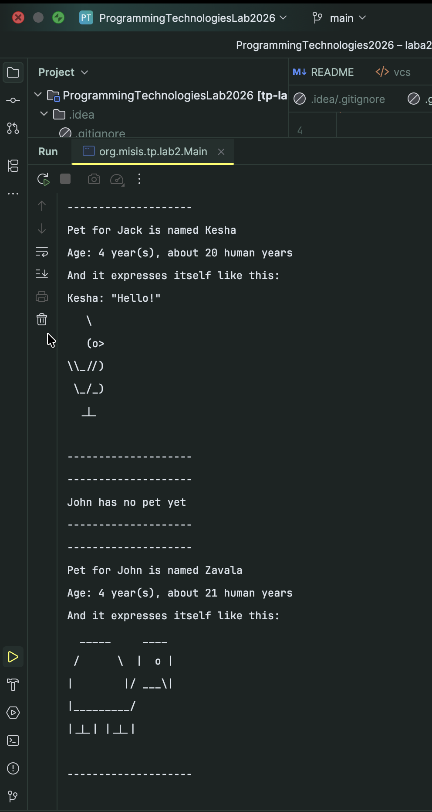

# Лаба 2 — Основы ООП и принципы проектирования

В этой лабораторной будут рассмотрены основные принципы ООП.

Объектно-ориентированное программирование (ООП) — парадигма программирования, в которой программа описывается как набор взаимодействующих объектов.

# Что нужно сдать к защите

Выполнять лабораторную можно на любом языке программирования.
Если в вашем ЯП нет отдельного понятия интерфейса, его можно заменить на абстрактный класс
с сигнатурами методов, но без полей и поведения.

На защите нужно продемонстрировать работоспособность кода, при этом он должен быть запушен в удалённый репозиторий
(тот же, что использовали в лабе 1, либо отдельный — как вам удобнее).

Если лабораторную делаете на Java — *переходите к разделу "Практика"*.
Если на другом ЯП — *ниже описаны требования к коду*, на раздел "Практика" можно ориентироваться в плане целевого поведения.

Если вы планируете делать лабораторную на Java, но плохо знакомы с языком — смотрите секцию ["Дополнительные материалы"](#additional_materials).

## Иерархия ООП

В результате выполнения лабораторной работы должна получиться следующая иерархия классов:



В основной программе нужно создать двух человек (объекты класса `Person`)
и привязать к ним двух компаньонов: объекты классов `Parrot` и `Turtle`.

После чего вызвать метод `getPetInfo()` для обоих объектов класса `Person`.

Метод `getPetInfo()` должен выводить имя человека, кличку питомца, его обычный возраст,
возраст в человеческих годах (`getAgeInHumanYears()`) и результат `express()`.
Если `pet == null`, метод должен писать, что у человека пока нет питомца.

**Данные о питомце должны браться из методов объекта, реализующего интерфейс `Pet`**.

Методы `express()` и `getAgeInHumanYears()` у классов `Parrot` и `Turtle` должны быть переопределены.

Пример вывода в консоль:

```
--------------------
Pet for Jack is named Kesha
Age: 3 year(s), about 15 human years
And it expresses itself like this:
Kesha: "Hello!"
   \
   (o>
\\_//)
 \_/_)
  _|_

--------------------
--------------------
John has no pet yet
--------------------
--------------------
Pet for John is named Zavala
Age: 4 year(s), about 21 human years
And it expresses itself like this:
  _____     ____
 /      \  |  o |
|        |/ ___\|
|_________/
|_|_| |_|_|

--------------------

```

# Вопросы к защите

1. Что такое ООП и в чем его преимущества?
2. Чем класс отличается от объекта?
3. Назовите четыре столпа ООП и коротко объясните каждый своими словами.
4. Зачем нужна инкапсуляция? Что плохого в публичных полях?
5. Для чего нужно наследование? Что такое композиция? Когда лучше не наследовать, а сделать композицию?
6. Что такое полиморфизм? Где именно в классе `Person` он проявляется?
7. Что такое абстрактный класс/интерфейс? Зачем они нужны?
8. Зачем нужны и что из себя представляют принципы SOLID?
9. **SRP.** Что такое Single Responsibility Principle? Как понять, что он нарушается?
10. **OCP.** Что такое Open/Closed Principle? Почему добавление третьего типа питомца (например, `Cat`) почти не требует править `Person` для работы с ним?
11. **LSP.** Что такое Liskov Substitution Principle? Что делать, если он нарушается?
12. **ISP.** Что такое Interface Segregation Principle? Оцените с его точки зрения интерфейс `Pet`.
13. **DIP.** Что такое Dependency Inversion Principle? От чего зависит класс `Person` — от `Turtle`/`Parrot` или от абстракции? Почему это важно?

# Практика

В рамках лабораторной работы будет использоваться ЯП Java и среда разработки IntelliJ IDEA (достаточно Community Edition).

Рекомендую использовать именно эту среду разработки при написании кода на Java —
она бесплатная и требует минимальных настроек.

Для начала установите JDK 17 или новее: [вот тут](https://adoptium.net/).

Далее необходимо скачать IntelliJ IDEA Community: [скачать](https://www.jetbrains.com/idea/download/).

После установки IDEA нужно сделать форк шаблонного проекта,
находящегося по [ссылке](https://github.com/tidbid-kt/tech-prog-labs-2026).

> Обратите внимание, форк необходимо делать только в том случае, если вы планируете делать лабы на Java, в остальных случаях настройка репозитория производится самостоятельно!

Жмём кнопку *Fork* на странице репозитория:



И создаём форк (вот [тут](https://docs.github.com/ru/pull-requests/collaborating-with-pull-requests/working-with-forks/fork-a-repo) можно почитать, что такое форки):



Именно в этом проекте вы и будете делать лабы.
Его можно удобно добавить себе локально через IntelliJ IDEA, полностью минуя терминал.

Для начала скопируйте транспортную ссылку на созданный вами форк
(кнопка **Code** → HTTPS или SSH, как удобнее):



Затем в IDEA нажмите **Get from VCS** и вставьте скопированную ссылку:



Сюда вводим ссылку (верхняя строка) и желаемый путь до проекта (нижняя строка):



Супер, проект импортирован — открываем и начинаем писать код.

## Классы и объекты

Для начала напишем простой класс, моделирующий абстрактную черепаху.
В рамках примера нам будет важно учитывать только кличку черепахи.
Также давайте считать, что единственным поведением нашего класса будет отрисовка себя в консоли — для 
черепахи отрисовываться будет, соответственно, черепаха.

Таким образом получаем одно поле (`name`) и один метод (`express`). Код для данного класса приведен ниже.

```java
package org.misis.tp.lab2;

public class Turtle {

    String name;

    void express() {
        System.out.println("""
                  _____     ____
                 /      \\  |  o |
                |        |/ ___\\|
                |_________/
                |_|_| |_|_|
                """);
    }

}
```

Дальше давайте создадим объект данного класса, конкретную черепаху по кличке `Sally`:

```java
package org.misis.tp.lab2;

public class Main {

    public static void main(String[] args) {
        Turtle sally = new Turtle();
        sally.name = "Sally";
        sally.express();
    }

}
```

Код рабочий, но отдавать поля наружу — плохая идея. Нужна инкапсуляция.

## Инкапсуляция

Инкапсуляция — это принцип, согласно которому внутреннее устройство сущностей нужно скрывать от вмешательств извне и 
объединять с поведением. При этом поведение (методы) и должно быть единственным механизмом изменения состояния.

Инкапсуляцию в Java можно обеспечить с помощью модификаторов доступа.

Доступ к объектам тогда становится возможен через открытые методы (контракт), а напрямую обратиться к полям становится нельзя.

Исправим наш код, добавим модификаторы доступа и конструктор:

```java
package org.misis.tp.lab2;

public class Turtle {

    private final String name;

    // новый конструктор
    public Turtle(String name) {
        this.name = name;
    }

    public void express() {
        System.out.println("""
                  _____     ____
                 /      \\  |  o |
                |        |/ ___\\|
                |_________/
                |_|_| |_|_|
                """);
    }

    // геттер для клички
    public String getName() {
        return name;
    }

}
```

Теперь просто так сменить кличку черепахе нельзя — она обязательно указывается при создании объекта.

Представим, что в нашу программу нам надо добавить новый класс: попугая.
Данные о попугаях мы хотим хранить те же, но хотим видоизменить поведение метода `express()` — очевидно что попугай внешне достаточно сильно отличается от черепахи.

Одним из самых простых решений данной проблемы является дублирование кода: мы копируем то, что есть в классе `Turtle` и вставляем в класс `Parrot`, изменяя нужные нам места.
Однако это не совсем рабочий подход, который очень сложно поддерживать. Принцип DRY явно указывает на то, что так делать не стоит. Вместо копирования давайте применим наследование.

## Наследование

Наследование позволяет создавать новые классы на основе существующих,
что способствует повторному использованию кода и созданию иерархий классов.
Это упрощает расширение функциональности и поддержание кода.

Наследование также способствует улучшению организации кода.
Классы могут быть организованы в иерархии,
где более общие классы находятся на верхних уровнях, а более специфические — на нижних.

Говоря абстрактно, и черепаха, и попугай — животные, так что имеет смысл вынести общую логику именно в класс `Animal`,
от которого и унаследуются данные классы.

Код нового суперкласса `Animal`:

```java
package org.misis.tp.lab2;

public class Animal {

    private final String name;
    private int age;

    public Animal(String name, int age) {
        this.name = name;
        this.age = age;
    }

    public void happyBirthday() {
        age++;
    }

    public void express() {}

    public String getName() {
        return name;
    }

    public int getAge() {
        return age;
    }

}
```

Теперь модифицируем класс `Turtle` (добавим наследование от `Animal` и уберем дублирующиеся методы и поля):

```java
package org.misis.tp.lab2;

public class Turtle extends Animal {

    public Turtle(String name, int age) {
        super(name, age);
    }

    @Override
    public void express() {
        System.out.println("""
                  _____     ____
                 /      \\  |  o |
                |        |/ ___\\|
                |_________/
                |_|_| |_|_|
                """);
    }

}
```

Кода стало гораздо меньше, потому что поведение теперь определено в суперклассе `Animal`.

Давайте напишем класс `Parrot`, тоже унаследовав его от `Animal`:

```java
package org.misis.tp.lab2;

public class Parrot extends Animal {

    public Parrot(String name, int age) {
        super(name, age);
    }

    @Override
    public void express() {
        System.out.println(getName() + ": \"Hello!\"");
        System.out.println("""
                     \\
                     (o>
                  \\\\_//)
                   \\_/_)
                    _|_
                    """);
    }

}
```

Супер, теперь в нашей программе мы можем создавать как попугаев,
так и черепах, и если вдруг их общее поведение изменится — нам нужно будет править его только в суперклассе
(`Animal`), а не в каждом классе отдельно.
Плюс к этому значительно упрощается добавление новых животных — просто наследуем их от `Animal`
и большая часть поведения для них будет уже прописана.

По нашей логике `Animal` является довольно абстрактной сущностью, однако в целом ничего не мешает нам в коде вызвать `new Animal(...)` и создать просто животное.
Исправить это нам поможет абстракция.

## Абстракция

Абстракция — это принцип, когда на самом верхнем уровне создаются классы, в которых как можно меньше описано "как делать", зато максимально подробно описано "что делать".

Чем меньше реализации в классе, тем он абстрактнее.

Это позволяет отделять контракты от механизмов их реализации, что значительно упрощает переиспользование и увеличивает гибкость кода.

В нашем случае `Animal` — набор признаков для абстрактного животного в рамках нашей программы, у него есть как контракты, так и какое-то общее для всех животных поведение/состояние, поэтому абстрактность у него средняя.

В Java для работы с абстракцией существуют абстрактные классы и интерфейсы, давайте применим оба сразу, сделаем `Animal` абстрактным и добавим к нему интерфейс
`Pet`, в него вынесем контракт, который должны выполнять все живые существа в рамках нашего приложения. А также немного дополним его, добавим метод `getAgeInHumanYears()` который позволит быстро узнать, а сколько тому или иному животному сейчас лет в человеческом выражении.

Таким образом `Pet` выше по уровню абстракции, чем `Animal`, а `Animal` выше чем конкретные реализации `Turtle` и `Parrot`.

Начнем с выделения интерфейса:

```java
package org.misis.tp.lab2;

public interface Pet {

    void express();

    String getName();

    int getAge();

    int getAgeInHumanYears();

}
```

Для интерфейса все методы изначально `public abstract` — то есть публичны и не имеют тела. В них задается только сигнатура (название метода, что он возвращает, какие аргументы принимает).

Отлично, теперь исправим класс `Animal`, добавим наследование от интерфейса (тут ключевое слово `implements`, хотя механизм тот же):

```java
package org.misis.tp.lab2;

public abstract class Animal implements Pet {
    private final String name;
    private int age;

    public Animal(String name, int age) {
        this.name = name;
        this.age = age;
    }

    public void happyBirthday() {
        age++;
    }

    public abstract void express();

    public abstract int getAgeInHumanYears();

    public String getName() {
        return name;
    }

    public int getAge() {
        return age;
    }
}
```

В `Pet` добавился новый метод (`getAgeInHumanYears()`), поведение которого разное для разных видов животных. Давайте переопределим его в `Turtle` и `Parrot`.

Для черепах будем считать, что за первый год жизни они стареют на 15 лет (быстрое взросление), а каждый последующий считается как два человеческих:

```java
package org.misis.tp.lab2;

public class Turtle extends Animal {

    public Turtle(String name, int age) {
        super(name, age);
    }

    // пишем реализацию метода для черепахи
    @Override
    public int getAgeInHumanYears() {
        if (getAge() <= 0) {
            return 0;
        }
        return 15 + (getAge() - 1) * 2;
    }

    @Override
    public void express() {
        System.out.println("""
                  _____     ____
                 /      \\  |  o |
                |        |/ ___\\|
                |_________/
                |_|_| |_|_|
                """);
    }

}
```

У попугая формула линейная, каждый год жизни как пять человеческих:

```java
package org.misis.tp.lab2;

public class Parrot extends Animal {

    public Parrot(String name, int age) {
        super(name, age);
    }

    // пишем реализацию метода для попугая
    @Override
    public int getAgeInHumanYears() {
        return getAge() * 5;
    }

    @Override
    public void express() {
        System.out.println(getName() + ": \"Hello!\"");
        System.out.println("""
                     \\
                     (o>
                  \\\\_//)
                   \\_/_)
                    _|_
                    """);
    }

}
```

Супер, теперь у нас есть общий интерфейс для всех наших животных, а абстрактное животное больше нельзя создать как объект (все почти как в реальной жизни).

Абстракция и наследование позволяют нам к объектам разных классов, но находящихся в одной иерархии, обращаться одинаково из внешнего кода. Это супер удобно и называется эта фишка полиморфизмом.


## Полиморфизм

Полиморфизм — это возможность обращаться одинаковым образом с сущностями разных типов.

Давайте создадим класс `Person` — человека, в рамках нашей логики у каждого человека есть некий живой питомец. В рамках текущего кода это может быть черепаха или попугай.
Благодаря тому, что наш код хорошо написан, мы можем в качестве питомца брать объект, реализующий интерфейс `Pet`.

Код класса `Person`:

```java
package org.misis.tp.lab2;

public class Person {

    private final String name;
    private Pet pet;

    public Person(String name) {
        this(name, null);
    }

    public Person(String name, Pet pet) {
        this.name = name;
        this.pet = pet;
    }

    public void setPet(Pet pet) {
        this.pet = pet;
    }

    public void getPetInfo() {
        System.out.println("--------------------");
        if (pet == null) {
            System.out.printf("%s has no pet yet%n", name);
            System.out.println("--------------------");
            return;
        }

        System.out.printf("Pet for %s is named %s%n", name, pet.getName());
        System.out.printf(
                "Age: %d year(s), about %d human years%n",
                pet.getAge(),
                pet.getAgeInHumanYears()
        );
        System.out.println("And it expresses itself like this:");
        pet.express();
        System.out.println("--------------------");
    }

}
```

В методе `getPetInfo()` просто выводим информацию о питомце.
Давайте продемонстрируем, что полиморфизм это действительно супер удобная штука, создадим двух человек с питомцами разных типов.

Исполняемый код:

```java
package org.misis.tp.lab2;

public class Main {

    public static void main(String[] args) {
        Parrot kesha = new Parrot("Kesha", 2);
        Turtle zavala = new Turtle("Zavala", 4);
        kesha.happyBirthday();

        Person jack = new Person("Jack", kesha);
        Person john = new Person("John");

        jack.getPetInfo();
        john.getPetInfo();

        john.setPet(zavala);
        john.getPetInfo();
    }

}
```

После его выполнения в консоль будет выведена информация о питомцах.

Супер! Обратим внимание, что в коде класса `Person` вызывается метод `getName()` и `getAgeInHumanYears()`, и `express()` интерфейса `Pet`, при этом поведение
берется из конкретных классов, которые реализуют интерфейс (`Parrot`/`Turtle`). Именно это и является ключевым преимуществом полиморфизма —
при работе с общим абстрактным типом поведение берется от объекта, который вызываем.

Давайте проверим, что в консоль действительно выводится ожидаемое поведение:



Отлично, все работает корректно.

Не забудьте закоммитить и отправить изменения!

## Итоговый код и SOLID

Посмотрим на получившийся код уже не с точки зрения столпов ООП, а с точки зрения принципов SOLID.

Важно понимать, что принципы SOLID — не четкие правила, а общие эвристики, которые полезно знать и держать в голове.
Если следовать им буквально, код будет получаться слишком сложным тогда, когда этого не требуется. 

Поэтому стоит проходиться по коду, оценивать, насколько в том или ином месте он соответствует принципам SOLID, и стоит ли в этом плане что-то менять.

Проведем такое упражнение с нашим кодом.

**S — Single Responsibility.**
Принцип про то, что у класса должна быть одна причина меняться.

`Animal` отвечает за общее состояние и поведение животного, `Person` — за человека и вывод информации о его питомце, `Turtle`/`Parrot` — только за поведение, уникальное для вида животного.
То есть в целом, зоны ответственности у классов определены хорошо, если мы захотим изменить то, как выглядят попугаи, изменение будет только в `Parrot`, `Animal` оно при этом не затронет.

То есть `SRP` мы в целом соблюдаем. Если бы он нарушался, имело бы смысл немного пересмотреть иерархию классов, выделить дополнительные суперклассы, или подробить текущие на более мелкие.

Нарушение же `SRP` плохо тем, что код становится нестабильным, и изменения в одном функционале, могут влиять на тот, который идейно непосредственно с ним не связан.

**O — Open/Closed.**
Принцип гласит, что код должен быть открыт к расширению и закрыт к модификации.

Если мы хотим добавить новый вид питомцев, например, `Cat`, то мы просто пишем новый класс, наследующий `Animal` (или реализующий `Pet`), а `Person` менять не придется: он уже работает через общий интерфейс `Pet`.

Таким образом по части расширения зоопарка наших питомцев мы данный принцип соблюдаем, что приятно! В целом здесь важны именно места расширяемости, везде невозможно заложить механизмы модификации поведения через расширение, важно
сделать это там, где такое расширение ожидаемо (или сделать это тогда, когда станет понятно, что оно ожидаемо). В нашем примере очевидно, что иерархия видов животных может расти и расти, поэтому для работы с ними в `Person` разумно использовать
интерфейс, а не привязываться к конкретным типам.

Таким образом получается, что новое поведение = новый класс, а не правка существующих. Это, опять же, помогает писать гибкий и устойчивый код.

**L — Liskov Substitution.**
Принцип говорит о том, что объект подтипа должен быть подставляем там, где ожидают базовый тип, без поломки смысла.

В `Person` лежит `Pet`, и туда спокойно можно положить и `Turtle`, и `Parrot`, что мы и делаем.

Пример нарушения: вид животного, у которого `getAgeInHumanYears()` бросает исключение "нельзя перевести возраст в человеческий" — формально тип подходит, но подстановка ломала бы `getPetInfo()`.
Если бы такой кейс возник, исправить бы его помог пересмотр иерархии — если не для всех животных можно вычислить их возраст в человеческих годах, значит эта возможность не должна быть частью общего контракта `Pet`, ее
нужно вынести ниже по иерархии, например, только в `Animal`, или сделать дополнительный класс/интерфейс, например `Ageable`.

**I — Interface Segregation.**
Принцип про то, что клиент не должен зависеть от методов, которые ему не нужны.

В нашем случае интерфейс `Pet` достаточно узкий: имя, возраст, число лет в человеческом выражении, `express()` — как раз то, чем пользуется `Person`.

Если бы в `Pet` добавили методы `fly()` и `swim()`, было бы нарушение и ISP (`Person` эти методы не нужны, но он от них зависит, то есть контракт для части клиентов слишком перегружен), и `LSP` (предыдущий принцип, потому что черепаха, например, летать не умеет). 
В случае необходимости этих методов завести их стоило бы в отдельные интерфейсы, например, в `Flyable` и `Swimmable`. Это и клиентам позволит зависеть только от нужных контрактов, и классовая иерархия будет более корректной (в Java возможно множественное наследование интерфейсов, то есть попугай бы тогда был `Parrot extends Animal implements Flyable`).

**D — Dependency Inversion.**
Принцип призывает к тому, чтобы модули верхнего уровня были зависимы от абстракций, а не от конкретных классов.
А также от абстракций должны зависеть модули нижнего уровня. А также еще и сами абстракции не должны зависеть от реализации!

В нашем случае `Person` зависит от `Pet`, а не от `Turtle` или `Parrot`. Именно поэтому нет нарушения, например `Open/Closed Principle`, что сильно упрощает расширение кода.

И сами `Turtle` и `Parrot` зависят от абстракции `Animal`, которая зависит от абстракции `Pet`. Зависит в данном случае буквально означает, что они их реализуют.

Ну и сами абстракции `Pet` и `Animal` не зависят от реализаций, в сигнатурах их методов не используются слишком узкие типы, характерные например только для определенных библиотек, что заставило бы
все реализации их использовать.

На самом деле `DIP` — один из самых важных принципов. С ним вы в полной мере можете использовать все преимущества ООП, но тут тоже важно не переусердствовать. Потому
что чем больше абстракций, тем во многом сложнее в них разбираться.

## Дополнительные материалы {#additional_materials}

Если вам интересно изучить Java — рекомендую обратить внимание на:

1. [4х часовой гайд по основам языка](https://www.youtube.com/watch?v=jPlBifPPri8), я на втором курсе тоже переходил с плюсов на джаву именно по гайду на ютубе, но тот был индусским и найти я его не смог(
2. [Java Rush](https://javarush.com/) — хорошая теория + практика
3. [Шилдт](https://drive.google.com/file/d/1SET713bVu7qKc5jPehO2Yc0Eldbm-EEO/view?usp=sharing) — прекрасная книжка, лучше после того, как освоите базовый материал
